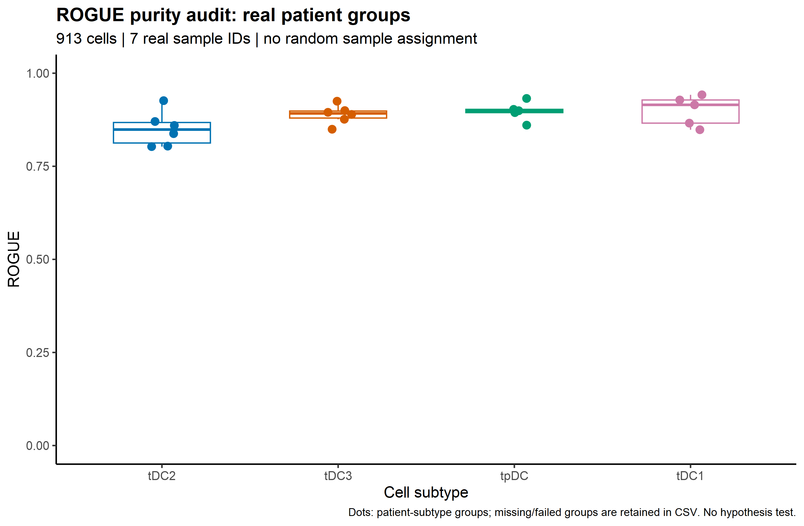

# ROGUE 亚群纯度审计 / Cluster purity QC

用张泽民团队提出的 ROGUE（Ratio of Global Unshifted Entropy）检查单细胞群体内部的转录异质性，辅助决定哪些亚群值得进一步检查。**低分不等于必须重新聚类，高分也不证明标签正确；本项目不自动选择分辨率、不删除细胞。**

English summary: A Chinese-first, provenance-aware ROGUE workflow and reusable skill. The real-data example checks execution, not biological validity or an automatic clustering decision.

## 真实图例 / Real-data example



图例：每个点是一个真实 `Patient × ct` 分组的 ROGUE 分数；箱体显示这些分组的分布，横轴按本次分数中位数排序，并不代表细胞谱系顺序。官方示例含 913 个细胞、9,795 个基因、7 个 Patient、4 类 DC 标签。26 个实际存在的分组中，22 个产生有限分数，4 个少于 10 个细胞而保留为 `INSUFFICIENT_CELLS`。不随机分配样本、不把细胞当成患者重复、不检验亚型间显著性。

**13 个分组有局部拟合警告（共 189 条），涉及近奇异性等。** 这些分数仅供审计示例，不能据此宣称群体纯度已被可靠证明。检查 [警告表](Results/fit_warnings.csv)、[分数表](Results/rogue_scores.csv)、[运行记录](Results/validation.json)；矢量图见 [PDF](Figures/rogue_purity.pdf)。`PASS` 在分数表中只表示得到有限且范围合法的数值，绝非拟合稳定性或生物学认证。

## 数据与环境 / Data and environment

数据来自 [ROGUE 官方 example.data](https://github.com/PaulingLiu/ROGUE/tree/6e1c8f9ee419c8c323ce9816841f78545dc17bf9/example.data)，不是公众号中随机分组的演示。原始 RDS 仅存本地、Git 忽略；固定提交、校验和与来源限制见 [Data/README.md](Data/README.md)。本次验证：Windows、R 4.3.1、ROGUE 1.0；其余包版本见 [sessionInfo](Results/sessionInfo.txt)。依赖 `Matrix`、`dplyr`、`tibble`、`ggplot2`、`jsonlite`、`digest`，无需 Seurat。

从仓库根目录执行。先在 R 中安装辅助依赖（老版本 R 应使用兼容包版本，不能强装要求更高 R 版本的最新版 Matrix）：

```r
install.packages(c("dplyr", "tibble", "ggplot2", "jsonlite", "digest"))
```

再在终端准备隔离的上游包；下面的目录首次创建，不覆盖已有安装：

```powershell
New-Item -ItemType Directory -Force runtime/R-library
git clone https://github.com/PaulingLiu/ROGUE.git runtime/ROGUE
git -C runtime/ROGUE checkout 6e1c8f9ee419c8c323ce9816841f78545dc17bf9
R.exe CMD INSTALL -l runtime/R-library runtime/ROGUE
$env:ROGUE_R_LIB = (Resolve-Path runtime/R-library).Path
Rscript Code/download_example.R
Rscript Code/run_rogue.R Data/DC.rds.gz Data/info.rds.gz Results/new_run UMI
```

上述为 Windows PowerShell 命令，需要 `R.exe`、`Rscript` 和 `git` 在 PATH；否则使用自己安装程序的完整路径。明确写 `R.exe`，避免 PowerShell 的 `r` 历史命令别名。下载器遇到已有输入会停止，**不会覆盖原始数据**。上述新运行写表到 `Results/new_run/`，图写到 `Results/Figures/`；已提交的示例图在根目录 `Figures/`，因此不会被这条示例命令覆盖。若下载过数据，跳过下载步骤并核对校验和。

## 换自己的数据 / Your data

准备未经归一化的 genes × cells count 矩阵 RDS，以及含 `CellID`、真实样本 ID、细胞标签的 metadata CSV 或 RDS。细胞集合必须完全相同且无重复；脚本按 count 列名对齐 metadata，拒绝负值、缺失值、非整数 UMI。不要用 HVG-only、scaled、integrated 或 log-normalized 矩阵代替全部可用 counts。

```powershell
Rscript Code/run_rogue.R Data/my_counts.rds Data/my_metadata.csv Results/my_run UMI sample_id celltype
```

第四个参数只接受 `UMI` 或 `full-length`，必须与平台匹配。默认分组列为 `Patient`、`ct`；默认 `span=0.6`、`min.cell.n=10`、`remove.outlier.n=2`、`filter=FALSE`。10 是上游执行下限，不是足够可靠的统计样本量保证。输出保留每组细胞数、数值、状态、警告数量及错误信息；缺少的分组不填 0，少细胞组不硬算。

## 如何作决定 / Decision guide

1. 先检查 count 来源、样本身份、QC、doublet、ambient RNA 和标签证据，特别是有冲突 marker 的群体。
2. 在真实样本内计算并查看拟合警告；比较不同标签时同时看每组细胞数和深度。不要机械使用统一 ROGUE 阈值，也不要在不同平台、参数下直接作排名结论。
3. 低分群体：先排技术混杂，再结合 marker、批次/样本分布及连续状态，决定是否单独重聚类。高分但 marker 冲突：仍要复核注释。
4. 若确需拆群，保留原标签映射，比较几个有理由的分辨率、可重复 marker 与跨样本支持；不为提高纯度分数无限拆小群。此处提供决策指南，**尚未实现自动分辨率比较**。

## 文件与调用 / Files and skill

`Code/download_example.R` 下载固定示例；`Code/run_rogue.R` 校验、分组计算、记录并绘图；`Data/` 保存数据来源和本地输入；`Results/` 保存实际审计表；`Figures/` 保存 PNG/PDF；`Notes/` 保存验证边界与来源。

可把此仓库作为技能包使用，入口为 [SKILL.md](SKILL.md)。在支持文件夹技能的客户端，将仓库克隆到其技能目录下的 `rogue-cluster-qc` 文件夹，重启/刷新后调用；GitHub 地址本身不会自动安装包或技能。不需要运行大数据示例才能阅读指南。

调用示例：“使用 rogue-cluster-qc，先检查我的原始 counts 与真实 sample_id，再审计 Fibroblast 各亚群是否需要进一步检查；不要自动删除细胞或用随机样本分组。”

## 来源与限制 / Sources and limitations

方法引用：[Liu et al., Nature Communications (2020)](https://www.nature.com/articles/s41467-020-16904-3)。公众号线索及许可差异见 [Notes/VALIDATION.md](Notes/VALIDATION.md)。本仓库为原创封装和中文指南，不是 ROGUE 官方项目；没有复制论文图或发布原始患者数据。发布前排除本地数据、环境、密钥与绝对用户名路径，未来新数据仍需单独安全审计。
